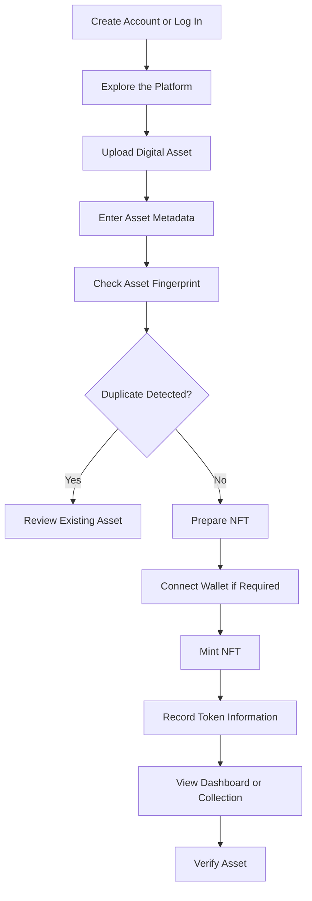

# ✨ Mintique — Mint. Verify. Own.

### A Digital NFT Minting & Authentication Platform

<p align="center">
  <strong>Create unique digital assets. Manage NFT collections. Explore digital ownership.</strong>
</p>

<p align="center">
  
  
  
  
</p>

---

## 📖 About the Project

**Mintique** is a web-based NFT platform designed to bring digital creation, token uniqueness, authentication, and asset management together in one place.

The platform is intended for digital artists, creators, and collectors who want to create digital assets, associate them with unique token identifiers, verify asset information, and manage their collections through an intuitive interface.

Mintique focuses on an important question in digital ownership:

**How can a digital asset be identified and distinguished from other assets?**

The project explores techniques such as unique token identifiers and content fingerprinting, alongside blockchain concepts, to support asset identification and authenticity verification.

> **Project motto:** Mint. Verify. Own.

## 🎯 Project Objectives

- Build a user-friendly platform for digital asset creation and NFT management.
- Provide user registration, login, and account management.
- Support digital artwork uploads and NFT creation workflows.
- Explore unique token identification and duplicate-content detection.
- Provide a verification interface for inspecting NFT and asset information.
- Organize created assets into collections and user dashboards.
- Explore wallet integration and blockchain-based ownership concepts.
- Develop a modular full-stack application with a responsive interface.

## ✨ Key Features

### 🎨 1. Digital Asset Creation
Upload digital artwork and provide the information required to create an NFT.

### 🪙 2. NFT Minting
Explore the minting workflow, including token identification and the association of digital assets with NFT records.

### 🔍 3. NFT Verification
Provide a dedicated verification workflow to inspect an NFT's identifier and available asset information.

### 🛡️ 4. Uniqueness and Duplicate Detection
Explore content fingerprints or hashes to identify identical digital files and help prevent duplicate asset registration.

**Important distinction:** A content hash can identify identical file content, but it does not automatically establish copyright, prove that an asset is globally unique, or prevent every form of duplicate NFT creation.

### 👛 5. Wallet Integration
Design the wallet connection workflow to support blockchain-related actions. Browsing the application should not require connecting a wallet; wallet connection is intended to be required when performing minting actions that need it.

### 🖼️ 6. NFT Collections and Marketplace
Organize digital assets into collections and provide a foundation for marketplace listings and purchase or sale workflows.

### 📊 7. User Dashboard
Provide a central place to view a user's assets, NFTs, collections, and related activity.

### 🎨 8. Modern User Interface
Use a dark visual theme, gradient accents, responsive layouts, and reusable interface components to create a polished digital-asset experience.

*Feature note: The descriptions above capture the project scope. Actual availability depends on the functionality implemented and configured in the current repository.*

## 🔄 How Mintique Works

The intended user journey is:



This is the intended workflow, not a claim that every step is currently connected end-to-end.

## 🏗️ System Architecture

Mintique is organized around a frontend, backend, data layer, and blockchain-related workflows.

| Layer | Technology / Responsibility |
|---|---|
| Frontend | React, TypeScript, Vite, HTML, CSS, and JavaScript |
| Backend | Django and Django REST Framework architecture |
| Authentication | User account and login workflows |
| Data layer | Supabase-related project files and Django application models |
| NFT module | Asset creation, token information, and NFT management |
| Marketplace module | Listings and marketplace-related workflows |
| Wallet module | Wallet connection and blockchain interaction workflows |
| Verification module | Asset lookup and authenticity-related checks |

### Architecture note

The current project snapshot contains both React/Supabase-related files and a Django project structure. These should be treated as separate or evolving parts until the active application flow is confirmed. Document the backend that actually serves your running frontend rather than assuming both are connected.

## 🛠️ Technology Stack

**Frontend**
- React
- TypeScript
- Vite
- HTML5 and CSS3
- JavaScript

**Backend**
- Python
- Django
- Django REST Framework, where configured

**Data and Authentication**
- Supabase-related project configuration
- Django models and authentication, where configured

**Blockchain Concepts**
- NFT token identification
- Content hashing and duplicate detection
- Wallet integration
- Smart-contract-based minting concepts

*Technologies listed under blockchain concepts are areas explored by the project; they do not imply that a deployed smart contract or live blockchain transaction is present.*

## 📂 Project Structure

The saved project snapshot contains a React frontend and a Django application structure. The following is a simplified overview of the main areas:

```text
mintique-nft/
├── src/
│   ├── components/       # Reusable UI components
│   ├── contexts/         # Shared frontend state
│   ├── lib/              # Shared utilities and integrations
│   └── pages/            # Frontend pages
│
├── supabase/
│   └── migrations/       # Database migration files
│
├── mintique/
│   ├── accounts/         # User accounts
│   ├── nft/              # NFT-related functionality
│   ├── marketplace/      # Marketplace functionality
│   ├── dashboard/        # Dashboard functionality
│   ├── wallet/           # Wallet-related functionality
│   ├── templates/        # Django HTML templates
│   ├── static/           # Static assets
│   └── manage.py         # Django management entry point
│
├── index.html
├── package.json
└── README.md
```

The exact location of `manage.py`, backend configuration, and other files may differ in your current checkout. This overview reflects the saved project layout rather than a verified final production structure.

## 🚀 Getting Started

### Prerequisites

- Git
- Node.js and npm
- Python 3
- A suitable Python virtual environment
- Backend and database credentials for whichever services the active application uses

### 1. Clone the repository

```bash
git clone <YOUR_MINTIQUE_REPOSITORY_URL>
cd mintique-nft
```

Replace the placeholder with your actual GitHub repository URL.

### 2. Install frontend dependencies

From the directory containing `package.json`, run:

```bash
npm install
```

### 3. Configure environment variables

Review the project's environment configuration and provide the required credentials for any active integrations.

Do not commit API keys, passwords, database credentials, or private wallet keys to GitHub.

### 4. Start the frontend

For the Vite-based frontend, run:

```bash
npm run dev
```

Open the local URL printed by Vite in your terminal.

### 5. Start the backend, if required

If the Django backend is part of your active application, enter the directory containing `manage.py`, activate your virtual environment, and install the backend dependencies from the project's requirements file.

Then run:

```bash
python3 manage.py migrate
python3 manage.py runserver
```

The exact directory, dependency file, database configuration, and environment variables must match your current checkout. Frontend and backend startup commands alone do not guarantee that all integrations are operational.

## 🧠 What I Learned

This project provides an opportunity to practise:

- Full-stack application organization.
- Building reusable frontend components.
- Connecting frontend interfaces to backend APIs.
- User authentication and session workflows.
- Digital asset handling and metadata management.
- Hashing concepts and duplicate-content detection.
- NFT token identification and verification concepts.
- Wallet integration and blockchain interaction fundamentals.
- Separating application responsibilities into modules.
- Debugging configuration and integration issues.

## 📌 Important Concepts to Remember

| Concept | Quick Revision |
|---|---|
| NFT | A token representing a particular digital or other asset within a token system |
| Token ID | An identifier for a token within its relevant contract or token system |
| Content hash | A fingerprint calculated from file content |
| Blockchain | A distributed ledger that records transactions and state changes |
| Wallet | A tool for managing blockchain accounts and authorizing transactions |
| Smart contract | Code deployed on a blockchain that enforces programmed rules |
| Metadata | Information describing an asset, such as its name, description, and media reference |
| Authentication | Verifying a user's identity |
| REST API | An interface that lets software components communicate over HTTP |

**Interview reminder:** Be ready to explain how Mintique identifies duplicate files, how token identifiers differ from file hashes, how a wallet authorizes a transaction, and which parts of your application currently rely on a database versus an actual blockchain.

## 🔮 Future Enhancements

Potential enhancements, subject to the project's scope, include:

- Integrating a deployed NFT smart contract.
- Storing media and metadata using IPFS.
- Recording on-chain token IDs and transaction hashes.
- Adding automated tests for authentication, minting, and verification.
- Strengthening duplicate detection and verification workflows.
- Improving error handling and transaction status feedback.
- Deploying the frontend and backend with secure configuration.

These are future possibilities, not claims of existing functionality.

## 👩‍💻 Author

**Jagrati Mishra**

- GitHub: [@jagratimishra05](https://github.com/jagratimishra05)

---

<p align="center">
  <strong>Mintique — Mint. Verify. Own.</strong><br />
  <em>Exploring digital ownership through full-stack development and blockchain concepts.</em>
</p>
